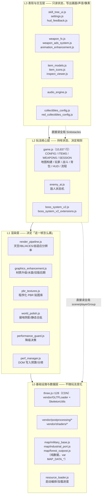

# 《战术突击》架构总览

> **读者**：三个月后接手这个项目的你。
>
> **本文目的**：不是解释「这游戏好玩在哪」，而是让你在改代码前知道**哪根线不能碰、碰了会怎样**。文末有四条红线和一份待核实清单。
>
> **评审基线**：`git ddf204a` + 54 项未提交改动（含 23 个未跟踪的顶层模块）。所有行号对应该基线的工作区状态。
>
> **配套文档**：
> - `docs/architecture/adr/ADR-001-threejs-r128-no-build.md`
> - `docs/architecture/adr/ADR-002-analytic-collision-over-mesh-raycast.md`
> - `docs/architecture/adr/ADR-003-procedural-pbr-shared-textures.md`
> - `docs/architecture/adr/ADR-004-adaptive-quality-guard.md`
> - `production/epics/S1-backlog.md`（接下来要干什么）

---

## 0. 一页速览

| 项 | 值 |
|---|---|
| 运行形态 | 双击 `index.html`，浏览器直接跑，无构建、无包管理、无服务端 |
| 引擎 | Three.js **r128**（CDN）+ 手工塞进 `vendor/` 的后期处理与 GLTF 工具 |
| 语言 | 原生 JavaScript，ES2015+ 语法，**全部 IIFE 挂全局**，无 import/export |
| 代码量 | 27 个 `.js`（24 个根目录 + 3 张地图），24,342 行；`game.js` 独占 10,837 行（44.5%） |
| 入口 | `index.html` 39 个 `<script>` 标签（第 1411–1451 行），顺序即架构 |
| 测试 | `tests/` 下仅有 1 个回归测试 `map-differences.mjs`（33 项断言）；其余为空白 |
| GDD | `design/gdd/` 目录存在但**为空**；事实上的设计文档是根目录 `游戏机制与内容丰富计划.md`（50KB） |
| 版本管理 | **1 个 commit，54 项未提交改动**，远程 `origin/master` 与本地同点（详见 §8） |
| 已知事故 | ①每帧递归 raycast 求视线 → 单帧 399ms、FPS 3 ②`WorldProps` 触发 TDZ → 道具全灭且异常被吞 |

**一句话判断**：这套代码的**运行时质量高于它的工程化质量**。性能事故被认真解决过、留了注释、留了降级链路；但版本管理、测试、需求追溯三项基本为零，且有一个 10,837 行的单文件把所有领域揉在一起。**风险不在「代码写错了」，而在「丢了就没了，改坏了不知道」**。

---

## 1. 模块分层

四层。分层的判据是**依赖方向**：上层可依赖下层，下层永不反向依赖。当前代码对这个规则的遵守程度见每层末的「违约」标注。



### 1.1 L0 基础设施与数据层

| 文件 | 职责 | 备注 |
|---|---|---|
| three.js r128 | 全部 3D 能力 | **CDN 加载，非本地**，断网即不可用（见 ADR-001 后果） |
| `vendor/GLTFLoader.js`、`vendor/SkeletonUtils.js` | 敌人 GLB 模型与骨骼克隆 | 版本已固定在仓库内 |
| `vendor/postprocessing/*`（6 个）、`vendor/shaders/*`（3 个） | Bloom / FXAA / 颜色校正链 | r128 时期的旧版 API，与新版不兼容 |
| `map/*.js`（3 个，共 1,284 行） | 地图数据：`var MAP_DATA_MILITARY / _INDUSTRIAL / _FOREST` | 纯数据对象，**在 three.js 之前加载**（`index.html:1411-1413`），所以绝对不能引用 `THREE` |
| `resource_loader.js` | 5 阶段启动编排、加载进度条、提示轮播 | 见 §3 里的隐藏时序契约 |

**分层违约**：`map/*.js` 被放在 three.js 之前是刻意的（纯数据先就位），但它违反了「基础设施依赖一致」——地图数据里没有任何 `THREE` 引用，这一条反而是全项目最干净的解耦。

### 1.2 L1 渲染层

这一层是过去三个月工程量最集中的地方，也是全项目**设计质量最高**的部分。

| 文件 | 行数 | 单一职责 |
|---|---|---|
| `render_pipeline.js` | 844 | 天空穹顶、方向光跟随玩家、PMREM 环境反射、Bloom→ACES→暗角/颗粒→FXAA、画质分级、自适应分辨率 |
| `graphics_enhancement.js` | 997 | 程序化 Canvas 纹理、渐变天空、动态水面、**旧版**后期链（被 RenderPipeline 取代后仍保留） |
| `pbr_textures.js` | 624 | 11 套无缝平铺 PBR 贴图（concrete/asphalt/gravel/grass/dirt/metal/corrugated/wood/sandbag/roof/brick），256²，法线由高度场 Sobel 生成 |
| `world_polish.js` | 317 | 接地软阴影（单 InstancedMesh）+ 静态几何合批（按材质签名分组 merge） |
| `performance_guard.js` | 169 | 0–4 共 5 级降级，只降不升 |
| `perf_manager.js` | 207 | DOM 节点缓存、写入去重、HUD 分频（20/12.5/30 Hz）、小地图底图离屏预渲染 |

**分层违约（重要）**：`render_pipeline.js` 与 `graphics_enhancement.js` 同时存在且都能渲染（`game.js:10807-10813` 的三级回落：RenderPipeline → GraphicsEnhancement → 裸 `renderer.render`）。两套后期链并存，只有一套生效，另一套是死重量与理解成本。**这是 L1 层最该清理的债**。

### 1.3 L2 玩法核心层

`game.js` 一个文件承担了 18 个 SECTION（编号还错乱，见 §7.1）：

```
SECTION  1  RARITY & CONFIG        行 6     – 66
SECTION  2  ITEMS & WEAPONS        行 67    – 533
SECTION  3  AUDIO SYSTEM           行 682   – 847
SECTION  4  GRID HELPERS + 拖拽    行 848   – 1047
SECTION  5  MAP DATA               行 1048  – 1628
SECTION  5  SESSION STATE          行 1629  – 1680   ← 编号重复
SECTION  6  THREE.JS SETUP         行 1681  – 1972
SECTION  7  MAP                    行 1973  – 2415
SECTION  8  PLAYER                 行 2416  – 2792
SECTION  9  WEAPONS (RAYCASTER)    行 2793  – 3237
SECTION 10  ENEMIES                行 3238  – 4832
SECTION 11  CONTAINERS & LOOT      行 4833  – 6789
SECTION 12  EXTRACTION             行 6790  – 6919
SECTION 13  ECONOMY                行 6920  – 6950
SECTION 14  HUD                    行 6951  – 7667
SECTION 15  LOBBY UI               行 7668  – 9890
SECTION 16  GAME FLOW              行 9891  – 10174
SECTION 17  EVENTS                 行 10564 – 10674
SECTION 18  MAIN LOOP              行 10675 – 10837
```

`enemy_ai.js`（588 行）实现 5 种敌人类型（scout/rifleman/commander/sniper/rusher）× 6 种状态（search/flank/take_cover/retreat/melee/dying）的状态机。`boss_system_v2.js`（1,279 行）+ `boss_system_v2_extensions.js`（1,228 行）是独立的 Boss 战斗子系统，共 **2,507 行**，体量已超过 `enemy_ai.js` 的 4 倍。

**分层违约（最严重的一条）**：L2 的 `game.js` 把 18 个领域塞在一个文件里，导致 L3 的所有模块必须反向依赖 `game.js` 的全局变量（见 §2）。这不是风格问题，而是**让任何单点改动都可能影响全局**的结构性问题。

### 1.4 L3 表现与交互层

| 文件 | 行数 | 职责 | 注入方式 |
|---|---|---|---|
| `item_models.js` | 1,273 | 战利品 3D 模型库，原型缓存 + `clone(true)` | 无状态，`typeof ITEMS` 弱依赖 |
| `weapon_ads_system.js` | 434 | 开镜位移/缩放/FOV | `init(camera, weaponGroup)` ✅ 显式注入 |
| `animation_enhancement.js` | 442 | 玩家武器与手臂姿态 | 读全局 `S`、`playerGroup` ❌ |
| `inspect_viewer.js` | 458 | 独立 WebGL 检视场景（480²），自建 DOM | 自持 renderer/scene ✅ |
| `weapon_fx.js` | 459 | 枪口火焰/抛壳/弹孔/火花，全对象池 | `init(scene, camera)` ✅ 显式注入 |
| `audio_engine.js` | 368 | WebAudio 程序化合成，干声/混响双 bus | 无状态 ✅ |
| `settings.js` | 507 | 设置面板与持久化 | 读全局 `S`、`CONFIG` ❌ |
| `skill_tree_ui.js` | 253 | 技能树 UI | 读全局 `S` ❌ |
| `hud_feedback.js` | 173 | 罗盘目标标记、伤害弧形 | 读全局 `playerGroup` ❌ |
| `item_icons.js` | 185 | 离屏 WebGL 渲染 96px 物品图标，缓存为 dataURL | 自持 renderer ✅ |
| `perf_manager.js` | 207 | HUD 写入预算（虽属 L1 职责，但只服务 UI） | 无状态 ✅ |
| `collectibles_config.js` / `red_collectibles_config.js` | 114 / 135 | 收藏品配置数据 | 读全局 `CONFIG` |

**这一层做对的事**：`weapon_ads_system`、`weapon_fx`、`inspect_viewer`、`item_icons`、`audio_engine` 都做到了「不吃全局、靠参数拿上下文」，可以直接抽成独立模块。**做到没做的事**：`animation_enhancement`、`hud_feedback`、`settings`、`skill_tree_ui` 反向依赖 L2 全局，是拆分层级的主要阻力源。

---

## 2. 全局命名空间：真正的耦合地图

没有模块系统，所有通信走 `window`。下面是我实测的引用次数（`grep -c`，已剔除同名形参造成的假阳性）：

| 模块 | `S.` | `obstacles` | `playerGroup` | `scene` | `CONFIG` | `ITEMS` | `damagePlayer` |
|---|---:|---:|---:|---:|---:|---:|---:|
| `boss_system_v2_extensions.js` | 4 | **16** | 6 | 11 | – | – | – |
| `boss_system_v2.js` | 3 | – | 9 | 1 | 11 | 4 | 4 |
| `enemy_ai.js` | 1 | 2 | 10 | 5 | 1 | – | 2 |
| `animation_enhancement.js` | 8 | – | 1 | – | – | – | – |
| `hud_feedback.js` | – | – | 4 | – | – | – | – |
| `settings.js` | 2 | – | – | – | 2 | – | – |
| `skill_tree_ui.js` | 1 | – | – | – | – | – | – |
| `item_icons.js` | 2 | – | – | – | – | – | – |
| `item_models.js` | 1 | – | – | – | – | 1 | – |
| `inspect_viewer.js` | – | – | – | – | – | 2 | – |

**结论**：`S` 被 6 个模块直接读写，`obstacles` 被 3 个模块（`enemy_ai` / `boss_extensions` / `world_props`）直接读，`playerGroup` 被 5 个模块读。这三个全局量就是事实上的公共 API，且它们没有类型、没有契约、没有变更记录。

### 2.1 `S` 是一个四合一对象

`game.js:1630` 的 `const S` 同时承担四种完全不同的职责：

1. **局内战斗状态**：`health` / `armor` / `magAmmo` / `isReloading`
2. **局内进度状态**：`lootValue` / `kills` / `containersSearched` / `extractProgress`
3. **背包与装备容器**：`backpack` / `secureContainer` / `pockets` / `keychain`（内含网格数据结构）
4. **UI 与流程标志**：`_fullMapOpen` / `_redCountAtOpen` / `_pendingRedGroundPickup` / `_lastLootValue`

`startGame()`（`game.js:9892`）的注释「Save equipped loadout before resetting S」暴露了后果：**每开一局，都要手工把十几个字段先存下来、重置 S、再恢复回去**，其中 `S.secureContainer` / `S.backpack` 直接整个对象替换。这是拆解 `game.js` 时必须先处理的第一个障碍——不先把 `S` 按职责切为 `CombatState` / `RaidProgress` / `Inventory` / `UiState`，任何拆分都会把 `S` 一起搬走，等于没拆。

### 2.2 `obstacles` 的四种含义

`obstacles` 数组（`game.js:1691` 声明）被四处以**不同的语义假设**消费：

| 消费方 | 期望的字段 | 隐含假设 |
|---|---|---|
| `raycastObstacles()`（`game.js:4681`） | `isAABB`+`halfW/halfD/height` 或 `radius/height` | `height` 缺省视为 **3** |
| `hasLineOfSight()`（`game.js:4765`） | 同上 + `isWater` | `height` 缺省视为 **3**，且 `h < 1.15` 不遮挡视线 |
| `isEnemyBlocked()`（`enemy_ai.js:550`） | `isAABB`+`halfW/halfD` | **忽略 height**，只看俯视投影 |
| `findNearestCover()`（`enemy_ai.js:22`） | `isAABB` + `mesh.position` | 障碍物即掩体，不看朝向 |

同一个 `height == null → 3` 的默认值被三处独立实现、各自解释。改任何一处默认值，都必须同时改三处，而没有任何编译期或测试期信号会提醒你漏了。

---

## 3. 初始化时序：从 `index.html` 到能开枪

### 3.1 脚本加载顺序（顺序即契约）

```
[数据先就位]
map/military_base.js → map/industrial_port.js → map/forest_outpost.js
        ↓ （此后 THREE 才可用）
three.js r128 (CDN) → GLTFLoader → SkeletonUtils
→ postprocessing/{Pass, CopyShader, FXAAShader, LuminosityHighPassShader,
                  EffectComposer, RenderPass, ShaderPass, MaskPass, UnrealBloomPass}
        ↓ （此后后期 API 才可用）
[纯配置数据]
red_collectibles_config.js → collectibles_config.js
        ↓
[功能模块：只定义、不执行]
weapon_ads_system.js → boss_system_v2.js → boss_system_v2_extensions.js
→ skill_tree_ui.js → resource_loader.js → render_pipeline.js → world_polish.js
→ perf_manager.js → hud_feedback.js → pbr_textures.js → item_models.js
→ item_icons.js → inspect_viewer.js → audio_engine.js → weapon_fx.js
→ world_props.js → performance_guard.js
        ↓
game.js            ← 定义全部玩法；末尾 BOOT 段调 ResourceLoader.startLoading(init)
        ↓
enemy_ai.js → animation_enhancement.js → settings.js → graphics_enhancement.js
```

**关键事实**：`settings.js` 和 `graphics_enhancement.js` 在 `game.js` **之后**才加载，但 `init()`（`game.js:1833`）里直接引用了 `GameSettings` 和 `GraphicsEnhancement`。这不崩，纯靠下面这条隐藏契约。

### 3.2 隐藏时序契约（没有写进任何地方，但撤销它会静默降级）

`game.js:10831` 的 BOOT 段：

```js
ResourceLoader.startLoading(() => { init(); });
```

`startLoading`（`resource_loader.js:164`）是 `async`，内部 `await` 五个阶段，其中 **阶段 3（音频 `canplaythrough`/`setTimeout 1500`）和阶段 4（图片 `onload`/`setTimeout 1000`）必然产生宏任务**。因此 `init()` 的实际执行时机被推迟到**所有 39 个 `<script>` 解析完毕之后**。

→ 这就是 `GameSettings` / `GraphicsEnhancement` 能出现在 `init()` 里的唯一原因。

**风险**：`init()` 里对这两个模块的调用全部包着 `typeof X !== 'undefined'` 守卫。一旦有人把 `ResourceLoader` 改造成同步执行（或删掉阶段 3/4 的 `setTimeout`），结果**不是报错，而是整条美术增强链和设置系统静默消失**——画面变回无后期、用户设置不生效，控制台一片安静。这是本项目最危险的隐性耦合。

> `graphics_enhancement.js:977` 的注释「自动初始化：game.js 先执行并调用 init()，此时本脚本还未加载」**与实际行为相反**，会误导接手者。已在 §9 待核实清单标记。

### 3.3 `init()` 内部时序

```
ResourceLoader.startLoading()
  ├─ 阶段1 环境检查            (10%)
  ├─ 阶段2 loadMapData()       (20%)   ← 把 MAP_DATA.mapSize 写进 CONFIG.mapSize
  ├─ 阶段3 预载 2 个音频        (40%)   ← 真正的异步等待点
  ├─ 阶段4 预载 1 个图标        (60%)   ← 真正的异步等待点
  └─ 阶段5 最终准备            (80%)
        ↓
init()                                 game.js:1833
  ├─ loadEnemyModels()                 GLB 加载（异步，不阻塞）
  ├─ ResourceLoader.showLoadingScreen()
  ├─ new THREE.Scene / Camera(78°, near .1, far 300)
  ├─ new THREE.WebGLRenderer            antialias:false, powerPreference:high-performance
  │    └─ setPixelRatio(min(dpr, 1.5))  shadowMap: BasicShadowMap
  ├─ playerRaycaster / enemyRaycaster   far = 250
  ├─ playerGroup ← camera，weaponGroup ← camera
  ├─ WeaponADS.init(camera, weaponGroup)
  ├─ setupLights()                      Ambient + Directional(1024², ±100) + Hemisphere
  ├─ lastTime = performance.now(); animate(lastTime)     ← 主循环先于地图启动
  └─ setTimeout(…, 100)                                  (55%)
        ├─ rebuildMapEnvironment()                       ← 最重的一步，见 §4.3
        ├─ setupEvents()                                 (70%)
        ├─ GameSettings.applySettings()                  ← 依赖 §3.2 的隐藏契约
        ├─ GraphicsEnhancement.init(renderer, scene, camera)
        ├─ RenderPipeline.init(renderer, scene, camera)
        ├─ WeaponFX.init(scene, camera)
        ├─ PerformanceGuard.init(renderer, scene)         ← 此后开始 1.2s 采样
        ├─ HudFeedback.init()
        ├─ BossSystemV2.init() → BossExtensions.init()
        ├─ lobbyScreen 隐藏 → loginScreen 显示            (95%)
        └─ setTimeout(…, 300) → hideLoadingScreen()
                    ↓
            玩家登录 → 大厅 → selectMap() → startGame()
                    ↓
            S.phase = 'playing'   ← 主循环进入玩法分支
```

**注意两个反直觉的顺序**：

1. `animate()` 在 `rebuildMapEnvironment()` **之前**就启动了。所以加载过程中主循环已经在跑，`S.phase === 'lobby'` 时只走「性能守卫 + 渲染」两段（`game.js:10801-10813`）。这是刻意的——为了让加载进度条能刷新。
2. `GraphicsEnhancement.init()` 在 `rebuildMapEnvironment()` **之后**。因此**第一次** `rebuildMapEnvironment()` 执行时 `GraphicsEnhancement.isEnabled() === false`，`WorldPolish.batchStatic()` 被跳过（`game.js:2007` 的显式守卫）。**结论：首局不做静态合批，draw call 偏高；必须先切一次地图或重启一局才会合批。** 这是一个已知的、被注释承认但没修的取舍。

---

## 4. 主循环时序

`animate(currentTime)`（`game.js:10680`）。分三段：**每帧必做** / **固定步长逻辑** / **分频 HUD**。

### 4.1 每帧必做（60/120/144 Hz，跟显示器走）

```
requestAnimationFrame(animate)
├─ frameDt = clamp((now - lastTime), …, CONFIG.MAX_FRAME_DT = 0.1)      ← 单帧最多按 0.1s 计
├─ FPS 统计（1s 窗口）→ 可选 fpsCounter DOM 更新
├─ if (S.phase === 'playing' && !GameSettings.isPauseOpen())
│    └─ 固定步长逻辑（见 4.2）
└─ PerformanceGuard.update(frameDt)                                     ← 内部用 performance.now()，忽略传入值
   WeaponFX.update(frameDt)
   渲染三级回落：RenderPipeline.render() → GraphicsEnhancement.render() → renderer.render()
   if (__PERF_DEBUG) 记录 window.__perfFrame = {js, render, total, calls, level}
```

`CONFIG.FIXED_DT = 1/60`，`CONFIG.MAX_FRAME_DT = 0.1`。

### 4.2 固定步长逻辑（`accumulator` 追帧，单帧最多 10 次子步）

```js
accumulator += frameDt;
let updates = 0;
while (accumulator >= FIXED_DT && updates < 10) {
    updatePlayer(FIXED_DT);      // 移动/碰撞/体力/流血
    updateEnemies(FIXED_DT);     // 模型 mixer + 动画状态 + AI 派发
    updateEnemyBullets();
    updateBulletTrails();
    updateParticles();
    updateExtract(FIXED_DT);
    updateTimer();
    updateGroundLootAnimation();
    accumulator -= FIXED_DT; updates++;
}
if (accumulator > FIXED_DT * 2) accumulator = 0;   // 追不上就丢弃，防死亡螺旋
```

**这个循环是性能红线之一**：`updates < 10` 上限 + `accumulator` 重置，让「卡一次」不会变成「永久卡」。改动它前先读 §6.3。

### 4.3 分频 HUD（`PerfManager.tick`）

| 通道 | 间隔 | 频率 | 内容 |
|---|---:|---:|---|
| `hud` | 0.05 s | **20 Hz** | `updateHUD()` + `updateWeaponUI()`（血条/弹药/负重/武器槽耐久） |
| `minimap` | 0.08 s | **12.5 Hz** | `updateMinimap()`（敌人/战利品/撤离点标记） |
| `compass` | 0.033 s | **30 Hz** | `updateCompass()`（罗盘与目标标记） |

`PerfManager.tick()` 返回 `{hud, minimap, compass}` 布尔值；主循环用「`!due` 时全刷」兜底（`PerfManager` 未定义时退回每帧全刷）。

**分频之外的每帧 UI 写入**（即：这些没被分频，靠「写入前比较签名」来省开销）：

| 项 | 去重机制 | 位置 |
|---|---|---|
| 动态准星扩散 | `_lastCrossSig` 字符串签名 | `game.js:10744-10755` |
| 低血量暗角 | `_lastVigSig`（`'on:'+数值` / `'off'`） | `game.js:10757-10772` |
| 蹲伏提示 | `_lastCrouch` 布尔 | `game.js:10774-10778` |
| 敌人血条朝向 | 每帧遍历，仅 `d² ≤ 900 && d² ≥ 9`（即 3–30 m）且 `health < maxHealth` 才更新 | `game.js:10780-10799` |
| 战利品追踪脉冲 | `S.lootValue !== S._lastLootValue` | `game.js:10738-10742` |
| **全屏大地图** | **无去重，`S._fullMapOpen` 为真时每帧 `drawFullMap()`** | `game.js:10736` |

最后一项是当前**唯一已知的每帧无节流重绘点**。大地图打开时 `drawFullMap()` 每帧重画整张地图（含建筑/容器/敌人/标记）。若后续收到「开地图掉帧」的反馈，**先查这里**。

### 4.4 `updateHUD()` 绕过分频的旁路

`updateHUD()` / `updateWeaponUI()` 在 `game.js` 里被 **30+ 处事件回调直接调用**（受伤、拾取、搜索、换枪……），不走 `PerfManager.tick`。这是正确的设计（事件应即时反映），但意味着：**20 Hz 分频只约束「空转刷新」，不约束「事件刷新」**。改 `PerfManager` 时不要以为改成 5 Hz 就能压住 UI 开销，事件路径不受影响。

---

## 5. 材质与几何管线（ADR-003 的落地细节）

### 5.1 `rebuildMapEnvironment()` 的八步顺序（不可调换）

`game.js:1989`：

```
1. clearMapEnvironment()                              销毁旧 group + geometry + material，清空 obstacles
2. createEnvironment()                                地面/道路/水域/树木/装饰物，登记 obstacles
3. WorldProps.apply(mapEnvironmentGroup, obstacles)   集装箱/路障/沙袋/路灯/铁丝网/水洼/路面标线
4. GraphicsEnhancement.upgradeEnvironmentMaterials()  把 Canvas 程序化纹理贴到盒体上
5. WorldPolish.batchStatic(mapEnvironmentGroup)       按材质签名合批（仅 isEnabled 时）
6. WorldPolish.apply(mapEnvironmentGroup, obstacles)  接地软阴影（单 InstancedMesh）
7. RenderPipeline.setTheme(MAP_DATA.theme)            重建天空/雾/光照/PMREM 环境反射
8. PerfManager.resetMinimapLayer()                    小地图底图下次重画
```

顺序的三条硬约束：

- **3 必须在 2 之后**：`WorldProps` 需要 `obstacles` 已有地图建筑，才能避让。
- **4 必须在 5 之前**：合批按「材质签名」分组，材质升级前的签名与升级后不同。顺序错了 → 合批按旧签名分组，之后材质变了但已 merge 进同一个 BufferGeometry，**纹理全部错位且不可恢复**（只有在下次切图时才会偶然「修好」，然后下次再错）。
- **5 必须在 6 之前**：`batchStatic` 会跳过 `isInstancedMesh`，但如果接地阴影先加进去，它的 `traverse` 收集会包含刚创建的对象，分组数量与 `materialKey` 缓存不稳定。

### 5.2 PBR 贴图的共享模型

`PBRTextures.get(kind)` 按 kind 惰性生成并**全局缓存**（`_sets[kind]`）。网格通过缩放 UV（`scaleUVs` / `scaleBoxUVs`）控制世界尺度平铺，**不克隆贴图**。`applyToMesh(mesh, kind, {tileU, tileV})` 是唯一入口。

- 盒体走 `scaleBoxUVs`，逐面按世界米数算 UV（`pbr_textures.js:541`）
- 平面/非盒体走 `scaleUVs`，按几何尺寸算（`pbr_textures.js:520`）
- 单张 256²，法线由高度场 Sobel 生成；`warmup()` 分帧预生成，避免开局卡顿

**红线**：改为每网格 `clone()` 贴图 = 显存爆炸（数百个网格 × 4 张 256² RGBA）。这条在代码里有注释，但注释不拦人，所以放进 §6.2。

---

## 6. 四条红线

> 写这节的原则：**每条都给「违反后的症状」**。因为三个月后的你不会读三个文件来确认顺序，但一定能认出「道具一件都没有」这个症状。

### 6.1 红线一：渲染顺序

**规则**
1. `<script>` 顺序不可调换。特别是 `map/*.js` 必须在 three.js 之前，`vendor/postprocessing/*` 必须在 three.js 之后、任何使用者之前。
2. 渲染必须走三级回落：`RenderPipeline.isEnabled()` → `GraphicsEnhancement.isEnabled()` → `renderer.render(scene, camera)`。
3. 材质升级 → 合批 → 接地阴影的顺序固定（§5.1 的 4→5→6）。

**违反后的症状**

| 违反项 | 症状 |
|---|---|
| `map/*.js` 移到 three.js 之后 | 白屏 + 控制台 `MAP_DATA_MILITARY is not defined`；若被 `typeof` 守卫吞掉，则**地图空无一物、玩家站在虚空里**，无报错 |
| `postprocessing/*` 早于 three.js | `THREE.EffectComposer is not a constructor`，整个后期链静默失效（`init` 内部 try/catch） |
| 跳过三级回落直接 `renderer.render()` | 天空穹顶消失、IBL 环境反射全黑（金属物件变漆黑）、ACES 调色丢失（画面发白发灰）、自适应分辨率失效（低端机掉到 5 FPS） |
| 合批早于材质升级（4↔5 互换） | **纹理错位**：集装箱/路障上的混凝土纹理方向错乱、比例像被拉扯；重启或用 `selectMap` 切一次地图后「自己好了」（因为下次顺序碰巧对），下次切回来又坏 → 表现为「随机出现的纹理错乱」 |
| 接地阴影早于合批（5↔6 互换） | 阴影贴片可能被合批进静态网格，出现「阴影随建筑一起被抬升/翻转」；或阴影整体消失 |

**怎么查**：`?perfdebug=1` 打开后在控制台看 `window.__perfFrame.calls`（draw call 数）。正常情况下切图后 `calls` 应显著下降（合批生效）；如果切图前后差不多，说明 `batchStatic` 没跑到，去查 `GraphicsEnhancement.isEnabled()`。

### 6.2 红线二：材质管线

**规则**
1. 所有 PBR 贴图只经 `PBRTextures.get(kind)` 取，**永不 `clone()`**。
2. 所有颜色贴图必须走 `GraphicsEnhancement.finalizeColorTexture()` 或等价处理，设置 `sRGBEncoding`。
3. 新增材质必须能被 `world_polish.js` 的 `_materialKey()` 归一化，否则不参与合批。
4. `performance_guard.js` 在 3 级降级时会**就地修改所有材质的 `normalMap = null` 和 `envMapIntensity = 0.1`**（`performance_guard.js:82-92`）——这是不可逆操作，任何「运行时重建材质」的代码都不能假设 `normalMap` 仍然存在。

**违反后的症状**

| 违反项 | 症状 |
|---|---|
| 每网格 `clone()` 贴图 | 显存暴涨，中端机在加载第 3 张地图时出现 `WEBGL_CONTEXT_LOST`（整页灰屏，需刷新）；DevTools Memory 里 `Texture` 数量随网格数线性增长 |
| 颜色贴图不设 `sRGBEncoding` | 全场景发灰发白、饱和度被压掉约 40%，金属看起来像塑料 |
| 材质的 `_materialKey()` 返回 `null` | 该批网格不参与合批，draw call 高出 2–4 倍；无任何报错或 warning |
| 降级后重建材质但没重设 `normalMap` | 画质从 3 级恢复到 1 级后**法线细节永久消失**（因为降级时把引用置了 null，没有备份）→ 表现为「玩久了之后画面越来越平」 |

最后一条是当前代码里的**真实待修项**：`performance_guard._apply(3)` 把 `m.normalMap = null` 后无法恢复，而 `_apply` 是「只降不升」的，所以只在**重开一局/切图重建材质**时才可能恢复。需确认 `upgradeEnvironmentMaterials` 是否会重新赋值 `normalMap`（见 §9）。

### 6.3 红线三：性能红线

**规则**

1. **敌人的视线判断必须用解析求交 + 节流，禁止 `raycaster.intersectObjects()` 递归。**
   - 唯一合法实现：`hasLineOfSight()`（`game.js:4765`），遍历 `obstacles` 做 slab/圆求交，`h < 1.15` 的低矮掩体不遮挡。
   - 唯一合法调用点：`enemy_ai.js:241`，**120 ms 节流**（`enemy._losNext = now + 120`）。
   - 已知残留违规：`game.js:3388` 的降级 AI 分支仍每帧调 `hasLineOfSight()`。目前走不到（`enemy_ai.js` 正常加载时 `EnemyAI` 已定义），但**一旦 `enemy_ai.js` 加载失败就会复活那个 399 ms 的 bug**。必须修。
2. **子弹遮挡必须用 `raycastObstacles()`（`game.js:4681`）的解析求交，禁止对 `mapEnvironmentGroup` 做 raycast。**
3. **主循环内禁止 `new THREE.*`。** 所有瞬时对象（火壳/火花/弹孔/硝烟）必须走 `weapon_fx.js` 的对象池。
4. **主循环内禁止 `querySelector` / `getElementById`。** 一律靠 `PerfManager.el()` 缓存或模块级 `_xxxEl` 懒引用。
5. **`updateHUD` / `updateMinimap` / `updateCompass` 只能经 `PerfManager.tick()` 的空转路径调用**，事件驱动的直接调用是允许且必要的旁路。
6. **固定步长上限 `updates < 10` 与 `accumulator` 截断不可移除。**

**违反后的症状**

| 违反项 | 症状（都是实测过的） |
|---|---|
| 每帧递归 `intersectObjects` 求视线 | **单帧 399 ms，FPS 掉到 3**。表现为「一进图就卡成幻灯片，但角色还能动」——因为渲染在跑，逻辑在追帧。DevTools Performance 里能看到一帧内 `Raycaster.intersectObjects` 占 95% 以上 |
| 子弹遮挡对网格 raycast | 开一枪卡 100–300 ms（地图 120+ 建筑，每栋数十个子网格 × 逐三角形） |
| 主循环 `new Mesh` | GC 尖峰 → 周期性 1–2 帧卡顿；长时间游玩后帧率阶梯下降（`scene.children` 无界增长） |
| 主循环 `getElementById` | 每帧数十次样式重算；`updateWeaponUI` 每帧重建 4 个武器槽 DOM 时最明显（`perf_manager.js` 头部注释记录了这段历史） |
| 移除 `updates < 10` 上限 | 一次长卡（切后台再回来）→ 累积 dt 巨大 → 单帧内追 200+ 个子步 → 卡死无法恢复。**这是死亡螺旋防护，删了会得到「切出去再回来就永久卡住」** |
| 全屏地图去掉每帧重绘 | 没有性能问题，但**地图上的敌人/标记会不刷新**（`drawFullMap` 无脏标记机制，靠每帧重绘保证实时性）→ 若要优化，必须先加脏标记而不是简单删调用 |

**怎么查**：`?perfdebug=1` → 控制台 `window.__perfFrame` 给出 `{js, render, calls, level}`。`js > 8ms` 说明逻辑超预算，`render > 8ms` 说明 GPU/绘制调用超预算，`calls > 300` 说明合批失效。`PerformanceGuard.getLevel()` 返回 0–4，非 0 说明已经在降级。

### 6.4 红线四：TDZ 禁区（这条曾经让全地图道具消失）

**规则**
1. `game.js` 中所有**模块级** `let` / `const` 从脚本开始执行到其声明行之间处于 **TDZ（暂时性死区）**。当前存在的模块级 `let/const`：
   - `game.js:1049-1056` `MAP_ZONES` / `FIXED_BUILDINGS` / `FIXED_EXTRACTS` / `FIXED_CONTAINERS` / `HARD_MODE_CONTAINERS` / `FIXED_GROUND_SPAWNS` / `HARD_MODE_GROUND_SPAWNS` / `groundLootItems`
   - `game.js:1616` `P`
   - `game.js:1630` `S`
   - `game.js:1682-1702` `scene` / `camera` / `renderer` / `clock` / `playerGroup` / `weaponGroup` / `enemies` / `obstacles` / `containers` / `extractPoints` / `bulletTrails` / `mapEnvironmentGroup` …
2. **任何在 `game.js` 执行到对应行之前运行的代码，禁止访问上述变量。** 包括 `map/*.js`、`vendor/*`、以及所有在 `game.js` 之前加载的模块的加载期顶层语句。
3. **`typeof x !== 'undefined'` 对 `let` / `const` 的 TDZ 完全无效——它仍然抛 `ReferenceError`。** 这个守卫只对「从未声明的全局」有效。

   > 实测（Node.js）：
   > ```
   > typeof on undeclared: false
   > typeof on TDZ let -> THROWS: ReferenceError: Cannot access 'y2' before initialization
   > ```
   > 所以 `world_props.js:632` 的 `typeof FIXED_CONTAINERS !== 'undefined' && FIXED_CONTAINERS` **是假保险**：如果它真的在 `game.js:1052` 之前被调用，会抛异常而不是安全返回 `[]`。

4. 需要 `game.js` 状态的模块，**必须通过函数参数注入**，不得直接读全局。已做对的范例：

   ```js
   WeaponFX.init(scene, camera)                            // ✅
   RenderPipeline.init(renderer, scene, camera)            // ✅
   WeaponADS.init(camera, weaponGroup)                     // ✅
   WorldProps.apply(mapEnvironmentGroup, obstacles)        // ✅
   ```

   做错的范例（直接读全局）：`enemy_ai.js` 读 `playerGroup` / `obstacles` / `scene`；`boss_system_v2*.js` 读 `S` / `playerGroup` / `damagePlayer`；`animation_enhancement.js` 读 `S`。

5. **`try/catch` 不得吞掉「本应致命」的初始化异常。** 至少要把错误写入一个全局错误通道，并让加载界面显示「某模块初始化失败」。当前 `rebuildMapEnvironment` 的 `WorldProps` 分支是 `console.warn('道具生成失败', e)` —— 一条控制台 warn，肉眼在 39 个 script 的日志里根本看不见。

**违反后的症状（这是真实事故，不是假想）**

| 症状 | 根因 |
|---|---|
| **所有集装箱、路障、沙袋、路灯、一根铁丝网都没有生成**，但地图建筑、敌人、容器、撤离点全部正常。控制台只有一行 `[WorldProps] 道具生成失败 ReferenceError: Cannot access 'containers' before initialization` | `world_props.js` 里引用了 `game.js:1690` 的 `let containers`。被 `rebuildMapEnvironment` 的 `try/catch` 吞掉 → 游戏看起来「只是地图变空旷了」，没有人会想到是异常 |
| 修复方式 | 改用地图数据里的 `FIXED_CONTAINERS`（`game.js:1052`，此时已初始化），并从 `game.js` 的 `MAP_DATA.containers` 复制。代码注释保留在 `world_props.js:630-632` |
| 任意模块「加载期」访问 `S` / `scene` | 老浏览器上抛 `ReferenceError` → 该 `<script>` 整块不执行 → 该模块所有全局名 `undefined` → 所有 `typeof` 守卫静默跳过 → **表现为「某个功能整块消失」，无报错** |
| `typeof` 假保险被当成护身符 | 开发者以为安全，实际在 TDZ 窗口内调用即崩，且崩在 `try/catch` 里 → 又是一次「功能静默消失」 |

**这条红线的真正教训**：不是「注意声明顺序」，而是 **`try/catch` + `console.warn` + `typeof` 三重静默，把一个硬崩溃变成了一个没人发现的功能缺失**。未来遇到「某某东西全都没有生成」，第一反应应该是**注释掉那个 `try/catch` 让它真崩**，而不是加打印。

---

## 7. `game.js` 拆分：风险评估与第一步

### 7.1 当前状态：10,837 行，18 个 SECTION，编号已错乱

`SECTION 5` 出现了两次（`MAP DATA` 和 `SESSION STATE`），而 `SECTION 17 EVENTS` 与 `SECTION 16 GAME FLOW` 之间夹着 389 行没有编号的「拖拽丢弃系统」（`game.js:10175-10563`）。这本身就是证据：**这个文件是持续追加出来的，不是规划出来的**。任何「按 SECTION 重排」的尝试都会踩到隐藏的相互引用。

### 7.2 风险分级

| 风险 | 说明 | 严重度 |
|---|---|---|
| **无编译期保护** | 无模块系统 → 拆出的模块只能靠 `<script>` 顺序 + 全局名通信。漏一个 `typeof` 守卫就是运行时崩溃 | 高 |
| **`S` 四合一** | 拆分必然要搬 `S` 的一部分，但 6 个模块在读同一个 `S`。搬一半 = 必然出现两份真值 | 高 |
| **`obstacles` 四种语义** | 拆碰撞/拆 AI/拆子弹会各建一个 `obstacles` 视图，而它们共享同一数组（§2.2） | 高 |
| **双向依赖** | `SECTION 15 LOBBY UI`（2,223 行）读 `SECTION 2 ITEMS`，`SECTION 11 LOOT` 读 `SECTION 15` 的 UI 函数，`SECTION 16 GAME FLOW` 读以上全部 | 中 |
| **`CONFIG` 是可变的 const** | `loadMapData()` 会改写 `CONFIG.mapSize` / `gameTime` / `enemyCount`。若把 `CONFIG` 拆出去做成不可变模块 → 地图切换断掉 | 中 |
| **无测试网** | 只有 1 个测试（`tests/map-differences.mjs`，33 项断言，覆盖地图数据字段与雾距逻辑）。拆分后仍无回归保护，只能靠手玩 | 高 |

### 7.3 推荐的拆分顺序（按「依赖少 → 依赖多」，不是按行数）

**第 1 批：可立即安全拆出（零 THREE、零 DOM、零 `S` 依赖）**

| 目标 | 源位置 | 行数 | 为什么安全 |
|---|---|---:|---|
| `src/core/grid.js` | `SECTION 4 GRID HELPERS`（`game.js:848-924`）+ 其后的纯算法函数 `canDropAt`(928) / `moveGridItem`(941) / `autoSortGrid`(953) | ~150 | 纯函数：`canPlaceInGrid` / `placeInGrid` / `removeFromGrid` / `findFreeSlot` / `initGrid` / `countGridItems` / `gridIsEmpty` / `canDropAt` / `moveGridItem` / `autoSortGrid` / `takeContainerItem`。输入输出都是普通对象，**天然可单测**。注意 `925-1047` 这一段是 `Drag & Drop` 的 DOM 事件层（`onDragStart` / `onDragOverCell` / `onDropOnCell` / `onDragEnd`），**不要一起拆**——那部分依赖 DOM 与全局 `dragData`，应留到第 2 批 |
| `src/data/rarity.js` | `SECTION 1 RARITY & CONFIG` | ~60 | 纯数据 + 权重函数 |
| `src/data/items.js` | `SECTION 2 ITEMS & WEAPONS`（`game.js:67-533`） | ~466 | 纯数据表。拆出后可用 JSON schema 校验缺字段（当前 `ITEMS` 有 20+ 个可选字段，没有任何校验） |

> **第一步就做 `grid.js`。** 理由：它是唯一「零外部依赖 + 有明确输入输出 + 有真实业务价值」的块。它同时是**新测试基建的第一个用户**——拆完立刻能写 15 个左右的断言（放置越界、重叠、旋转、自动整理、负坐标），让 `tests/` 从空变成有东西。这一步的风险接近于零，但收益是「团队第一次有了可执行的回归网」。

**第 2 批：边界清晰，但需要 `S` 的只读视图**

| 目标 | 源位置 | 行数 | 前置条件 |
|---|---|---:|---|
| `src/ui/search-grid.js` | `SECTION 11` 的搜索网格渲染与拖拽（`game.js:5284-6100` 区间） | ~800 | 先定义 `S` 的只读投影接口 |
| `src/ui/hud.js` | `SECTION 14 HUD` + `Full Map System` + `Marker Guide HUD` | ~716 | 只读 `S`，可先行 |
| `src/data/map-sources.js` | `MAP_SOURCES` + `selectMap` + `initMap`（`game.js:7685-7713`） | ~30 | 顺手把 `MAP_DATA` 的深拷贝语义写进注释 |

**第 3 批：高风险，需要先重构 `S`**

| 目标 | 源位置 | 行数 |
|---|---|---:|
| `src/gameplay/inventory.js` | `SECTION 11 CONTAINERS & LOOT` + 装备系统 | ~1,957 |
| `src/gameplay/combat.js` | `SECTION 8 PLAYER` + `SECTION 9 WEAPONS` + `SECTION 10 ENEMIES` | ~1,456 |
| `src/gameplay/economy.js` | `SECTION 13 ECONOMY` + 经验/成就/技能树（`game.js:4291-4830`） | ~600 |

**第 4 批：最后动**

| 目标 | 源位置 | 行数 | 备注 |
|---|---|---:|---|
| `src/ui/lobby.js` | `SECTION 15 LOBBY UI` | **2,223** | 单块最大。内含存盘、商城、装备配装、任务链、成就、排行榜、地图选择，全部耦合 `P` |
| `src/game/flow.js` | `SECTION 16 GAME FLOW` + 拖拽丢弃 + `SECTION 17 EVENTS` | ~1,170 | 含 `startGame` / `endGame` 的全部状态迁移 |
| `src/game/loop.js` | `SECTION 18 MAIN LOOP` | ~163 | 最后一行。它是所有东西的汇聚点 |

### 7.4 第一步之前必须先做的一件事

`grid.js` 拆出时，`S.secureContainer` / `S.backpack` 是网格对象、`P.stashGrid` 也是。这三个网格对象目前由 `initGrid(rows)` 生成，形状是 `{cols, _items:[...]}`。拆 `grid.js` 时**保持这个数据形状不变**（不要顺手改成 class），否则所有读 `_items` 的地方一起炸。**拆文件不等于改数据模型。**

---

## 8. 版本管理风险与补救

### 8.1 现状（这一节请优先读，风险高于全部技术债）

```
本地分支：master
远程：    origin → github.com/Zcf695/tactical-assault-fps.git
提交数：  1
HEAD：    ddf204a  "🎯 Initial commit: 战术突击 v4.0"   (2026-07-24)
ahead/behind: 0 / 0        ← 远程与本地同一个点
未提交改动：54 项
```

**这唯一一个 commit 里只有 9 个文件**：

```
.github/copilot-instructions.md   .gitignore   IDEA.md   README.md
game.js  index.html
map/forest_outpost.js  map/industrial_port.js  map/military_base.js
```

**工作区与这个 commit 的差距**：

| 文件 | 已提交 | 工作区 | 差 |
|---|---:|---:|---:|
| `game.js` | 3,933 行 | **10,837 行** | **+6,904 行（+175%）** |
| `index.html` | 621 行 | 1,453 行 | +832 行 |
| `map/*.js` ×3 | 1,284 行 | 1,279 行 | 重写 |
| **其余 23 个顶层模块** | **0** | **~11,700 行** | **完全未跟踪** |

```
game.js                | 8392 +++++++++++++++++++++++++++
index.html             | 1000 +++++-
map/forest_outpost.js  |  527 +--
map/industrial_port.js |  504 +--
map/military_base.js   |  734 +--
5 files changed, 9726 insertions(+), 1431 deletions(-)
```

未跟踪的 23 个模块里，包括**整个渲染管线**：`render_pipeline.js`、`pbr_textures.js`、`graphics_enhancement.js`、`world_polish.js`、`performance_guard.js`、`enemy_ai.js`、`boss_system_v2.js` + `_extensions.js`、`item_models.js`、`world_props.js`，以及整个 `vendor/` 目录（12 个文件）。

**所以：如果这台机器的硬盘今天坏掉，能恢复的只有那个画质朴素、3933 行 game.js、没有渲染管线、没有 PBR、没有道具、没有 AI 增强、没有 Boss 系统的版本。项目会倒退约三个月，且倒退后的版本无法加载 `vendor/` 里的后期库（因为 vendor 未跟踪）。**

### 8.2 附带风险

| 项 | 现状 |
|---|---|
| 备份策略 | 靠手工 `game.js.bak` / `.bak2` / `.bak3`（520–561 KB × 3 ≈ **1.6 MB**）+ `map/*.js.bak` × 3，全部**未跟踪**且**未 ignore** |
| `.gitignore` | 只覆盖 IDE / OS / `.context/` / `.hermes/` / `node_modules/` / `dist/` / `build/`。**没有 `*.bak`、没有 `*.png`、没有大资源目录**，所以 `git add .` 会把截图（1.3 MB × 4）和 58 MB 的项目一起塞进去 |
| 仓库体积 | 工作区 58 MB（含 `models/`、`audio/`、`收藏品/`、`搜索音效/`、`装备及药品等杂项/`），`.git` 仅 204 KB |
| CI | `.github/` 只有一个 `copilot-instructions.md`，无语义化的 workflow |
| 版本号 | `README.md` 徽章写 `version-4.3`，唯一 commit 写 `v4.0`，代码里没有版本常量 → 无法从代码判断当前版本 |
| `TODO` 标记 | **24,342 行里 0 个 `TODO` / `FIXME` / `HACK`。** 技术债完全不可见，只存在于人脑和 `.bak` 文件的 diff 里 |
| 代码里的注释密度 | 极不均匀：`render_pipeline.js`/`pbr_textures.js`/`perf_manager.js` 有完整 JSDoc；`game.js` 的 `SECTION 10-11` 大量单行压缩代码（`function a(){b();c();}` 千字符成行） |

### 8.3 补救（按顺序，第 1 步今天就该做）

**S-01 立即止血（0.5 小时）**

1. 先补 `.gitignore`，把不该进仓库的挡在外面：
   ```
   *.bak
   *.bak2
   *.bak3
   *.png
   screenshot*.png
   ui_*.png
   .workbuddy/
   ```
   注意：`models/`、`audio/`、`收藏品/`、`搜索音效/`、`装备及药品等杂项/`、`vendor/` **必须进仓库**（它们是运行时依赖，`双击 index.html` 能跑全靠它们）。`vendor/` 12 个文件加起来不到 1 MB，值得。
2. 一次提交所有现存代码，commit message 里写清「一次性收口：把 3 个月未版本化的改动纳入基线」，并在正文列出这 23 个模块的名字。
3. `git tag baseline/s1-ddf204a-working`，打上可回退的锚点。
4. `git push origin master` —— **远程当前只有 3933 行的旧版本，这一步才是真正的备份生效**。

**S-02 建制（1 小时，与 S-01 同一天）**

5. 采用轻量分支约定（不需要 GitFlow）：
   - `master` = 总能双击打开跑通的状态
   - `wip/<主题>` = 任何改动
   - 合并前必须：①`index.html` 能开 ②一局撤离成功 ③切一次地图不掉帧（三条手工验收，写进 README）
6. 约定 commit message 前缀：`feat:` / `fix:` / `perf:` / `refactor:` / `docs:` / `chore:`。理由：三个月后 `git log --oneline | grep perf:` 就是一份性能变更史。
7. 禁止再用 `game.js.bak`。历史交给 git，需要对比用 `git diff`。

**S-03 建立可见的技术债清单（2 小时）**

8. 新建 `docs/architecture/debt.md`，把本文 §6 的红线检查项 + §7.2 的风险表逐条转成可勾选条目，每条带「症状」。
9. 开始允许 `TODO(owner, 日期)` 格式。0 个 TODO 不是好事的证据，是「债务没有记账」的证据。

**S-04 最低限度的 CI（半天）**

10. 加一个 GitHub Actions job：`node --check` 跑过所有 `.js`。这一步能拦住「语法错误提交」，成本 10 行 YAML。
11. 第二步再加 `tests/run.js`（`grid.js` 拆出后立刻就有内容）。

---

## 9. 待核实清单

以下是本轮评审**未能确认**、且会显著影响判断的点。按优先级排列，每条都写了「怎么核实」。

| # | 待核实 | 为什么重要 | 怎么核实 |
|---|---|---|---|
| 1 | `render_pipeline.js` 与 `graphics_enhancement.js` 的后期链是否有重复 bloom/重复 tone mapping | 两套链并存，若 Switch 时只 `setEnabled` 不销毁，可能同时在跑两遍后期 → 双倍 GPU 开销 | 在 `RenderPipeline.init` 成功后打印 `GraphicsEnhancement.isEnabled()`；`?perfdebug=1` 对比开关前后的 `render` 耗时 |
| 2 | `performance_guard` 3 级降级把 `normalMap = null` 后，画质恢复路径是否会重建 | 若不重建，法线细节永久丢失（§6.2 最后一条） | 断点 `_apply(3)` → 再触发 `RenderPipeline.applyQuality(false)` → 检查材质的 `normalMap` 是否为 `null` |
| 3 | `GraphicsEnhancement.upgradeEnvironmentMaterials()` 是否会重新赋 `normalMap` | 同上；也是「切图后画面变好」这个现象的候选解释 | 读 `graphics_enhancement.js:636` 全文，确认是否每次调用都重新 `applyToMesh` |
| 4 | `MAP_DATA` 被深拷贝重建后，是否有模块缓存了旧子对象引用 | `selectMap` 执行 `MAP_DATA = JSON.parse(JSON.stringify(src))`（`game.js:7696`）。若 `RenderPipeline` / `WorldProps` 存了 `MAP_DATA.theme` 的引用，切图后会指向旧对象的副本 | `grep -n "MAP_DATA\.\(theme\|roads\|trees\)" *.js` 查是否有模块级缓存；重点查 `render_pipeline.js:_theme` |
| 5 | `boss_system_v2.js` 与 `boss_system_v2_extensions.js` 的职责边界 | 2,507 行分两个文件但都挂 `BossSystemV2`/`BossExtensions` 两个全局，且都读 `S`/`playerGroup`/`obstacles`。不清楚为何要拆，可能是文件大小限制 | 对比两个文件的 `init()`：`BossSystemV2.init()` 与 `BossExtensions.init()` 各注册什么 |
| 6 | `item_icons.js` 与 `inspect_viewer.js` 各自 `new THREE.WebGLRenderer()` 是否可控 | 这两个模块各持一个独立 WebGL 上下文。浏览器 WebGL 上下文上限通常 8–16 个。若 `ItemIcons` 未释放，多次开关背包可能耗尽上下文 | DevTools 查 `renderer.info`，或在 `ItemIcons` 里打 `console.log(renderer.getContext())` 计数 |
| 7 | `game.js:3388` 的降级 AI 分支是否还有其它「每帧 raycast」残留 | 这是 399 ms 事故的同类代码，只是当前不可达 | 全文搜 `intersectObjects` / `intersectObject`，确认剩余调用点是否都在事件路径（开枪/搜索）而非每帧路径 |
| 8 | `S.phase` 的完整取值集合与迁移图 | 只知道 `'lobby'` / `'playing'`。还有没有 `'dead'` / `'extracting'` / `'ended'`？流程控制的正确性依赖它 | `grep -n "S.phase\s*=" game.js` 全量枚举，画状态图 |
| 9 | `game.js` 的行内压缩代码段是否由工具生成 | `SECTION 10-11` 有大量千字符单行（如 `updateBulletTrails` 整个函数一行）。若是格式化工具产物，重新格式化会产出巨大 diff；若是手工，说明有人为了避免合并冲突而压缩 | 看 `git log -p` 不可行（只有 1 个 commit）。只能问原作者 |
| 10 | 三张地图的 `mapSize` 都是 300，但 `CONFIG.mapSize` 默认 110 | `loadMapData()` 会覆盖（`game.js:1067`），所以当前是对的。但 `createEnvironment()` 用 `CONFIG.mapSize` 建地面，若 `loadMapData()` 未跑（例如 `MAP_DATA` 为 `{}`），地面会是 110×110 而地图对象在 ±150 → 走出地面边界 | 在 `init()` 开头打 `console.log(CONFIG.mapSize, MAP_DATA.mapSize)` |

---

## 10. 附录：文件清单

| 文件 | 行数 | 层 | 单一职责？ |
|---|---:|---|---|
| `game.js` | 10,837 | L2 | ❌ 18 个领域 || `boss_system_v2.js` | 1,279 | L2 | 待核实 |
| `item_models.js` | 1,273 | L3 | ✅ |
| `boss_system_v2_extensions.js` | 1,228 | L2 | 待核实 |
| `graphics_enhancement.js` | 997 | L1 | ⚠️ 与 RenderPipeline 重叠 |
| `world_props.js` | 906 | L1/L2 | ⚠️ 既建几何又写 obstacles |
| `render_pipeline.js` | 844 | L1 | ✅ |
| `pbr_textures.js` | 624 | L1 | ✅ |
| `enemy_ai.js` | 588 | L2 | ✅（但读全局） |
| `map/military_base.js` | 550 | L0 | ✅ 纯数据 |
| `settings.js` | 507 | L3 | ✅ |
| `weapon_fx.js` | 459 | L3 | ✅ |
| `inspect_viewer.js` | 458 | L3 | ✅ |
| `animation_enhancement.js` | 442 | L3 | ✅（但读全局） |
| `weapon_ads_system.js` | 434 | L3 | ✅ |
| `map/forest_outpost.js` | 380 | L0 | ✅ |
| `audio_engine.js` | 368 | L3 | ✅（与 `game.js:682` 的 SFX 重复） |
| `map/industrial_port.js` | 354 | L0 | ✅ |
| `world_polish.js` | 317 | L1 | ✅ |
| `resource_loader.js` | 261 | L0 | ✅ |
| `skill_tree_ui.js` | 253 | L3 | ✅ |
| `perf_manager.js` | 207 | L1 | ✅ |
| `item_icons.js` | 185 | L3 | ✅ |
| `hud_feedback.js` | 173 | L3 | ✅ |
| `performance_guard.js` | 169 | L1 | ✅ |
| `red_collectibles_config.js` | 135 | L3 | ✅ 纯数据 |
| `collectibles_config.js` | 114 | L3 | ✅ 纯数据 |
| **合计** | **24,342** | | |

已知重复实现（拆分层级时可合并）：

- `game.js:682-847`（SFX：`playTone` / `playNoise` / `sfxShoot` / `sfxHit` / `sfxReload` …）与 `audio_engine.js`（`AudioEngine.play(name, opts)` / `startAmbient`）是两套并行的音频实现。README 声称「程序化音频引擎」，实际上 gameplay 走的是 `game.js` 里那套简单的 `playTone`。
- `graphics_enhancement.js` 的后期链与 `render_pipeline.js` 的后期链重叠（§9-#1）。
- 三张地图各有一个 `.bak` 文件（未跟踪，`map/*.js.bak`），与主文件同目录，容易误读。

---

## 11. 协作与提交纪律

> 本节由主理人拍板，2026-11 基线建立后生效。适用于所有以「工作区」为产出的成员。
> 背景：S1 止血时发现，三个月的工作产出（23 个模块）从未进过版本库；而止血提交完成后的几分钟内，
> 工作区又因为多人并行写盘重新变脏。下面三条规定是那次教训的直接产物。

### 11.1 提交权收归一人

**只有技术负责人（engineering-lead）执行 `git commit`。** 其他成员只写盘、不提交。

理由：多人并行 `commit` 会产生交错的半成品历史，且无法保证每次提交前都跑过校验。写盘可以并行，提交必须串行。

### 11.2 每次 commit 前必跑三条

```bash
# ① 语法：全部非 vendor 的 JS 必须通过
for f in $(git ls-files -co --exclude-standard '*.js' | grep -v '^vendor/'); do node --check "$f" || exit 1; done

# ② 地图数据与渲染契约（纯 Node，秒级）
node tests/map-differences.mjs --fast

# ③ 玩法数值平衡（当前预期 exit 1，只记录不阻塞——它是设计锚点，不是代码缺陷）
node tests/balance-sim.mjs --check --state=current
```

> **禁止为了让 ③ 变绿去改脚本里的目标值。** 顶级配装 8–15 局是设计锚点；改测试等于把体温计泡热水里。

完整模式 `node tests/map-differences.mjs`（含浏览器性能门，约 4 分钟）在合并到 `master` 前跑一次即可。

### 11.3 比对基线看 commit，不看 `git status`

**工作区「干净」的状态只有几分钟寿命**——多人并行写盘时，`git add -A` 之后队友再落盘就会立刻产生新的未版本化改动。

因此：
- 「有没有丢东西」要比对 **commit**（`git log` / `git show --stat` / `git rev-list --left-right --count origin/master...master`），不看 `git status`。
- 判断「某次改动是否已入库」用 `git log -S'<关键字>'` 或 `git show <commit>:<path>`，不看文件是否存在。
- `git status` 只用于「这次我要提交什么」。

### 11.4 里程碑离线 bundle 制度

**每次 `push` 成功后，紧接着生成一份离线 bundle：**

```bash
git bundle create ../tactical-assault-<里程碑名>-<YYYYMMDD>.bundle --all
git bundle verify ../tactical-assault-<里程碑名>-<YYYYMMDD>.bundle
```

保留最近 **3 份**，放项目目录之外（第二块盘 / 网盘）。

理由（不是洁癖，是实测）：
1. **本机出网不稳定**。S1 止血时第一次 `git push` 报 `schannel: server closed abruptly (missing close_notify)`，但 ref 其实已更新；随后 3 次重试全部被环境代理返回 `502 CONNECT`。「现在能推」不能推导「以后能推」。
2. **`git push` 的返回码不可信**，要用 `git ls-remote --heads --tags origin` 核实远端实际状态。
3. **bundle 只包含 commit，不包含工作区**。所以它只保护「已提交」的部分——这也从反面说明为什么 11.1/11.2 必须执行。

### 11.5 一个已验证的例外：`kind` 字段偏离了主理人指令

主理人最初要求「改 `world_props.js` 的 `isForest` 正则，加上『密林』」。实际落地时改成了
**地图数据里的显式 `kind` 字段作为主判据，正则降级为 deprecated 兜底**。偏离的理由已在
`world_props.js` 的注释里写明（显示名驱动 13 处密度分支 + 道具种子是 `map.name` 的哈希）。
主理人复核后保留该偏离，并明确：**这类情况以成员文档为唯一事实源，主理人的消息只做优先级与口径，不做数据搬运。**

适用于以后的判断：**当「照字面执行指令」与「修掉根因」冲突时，可以偏，但必须（1）满足原验收判据（2）在代码里写清理由（3）主动上报让对方复核。**
