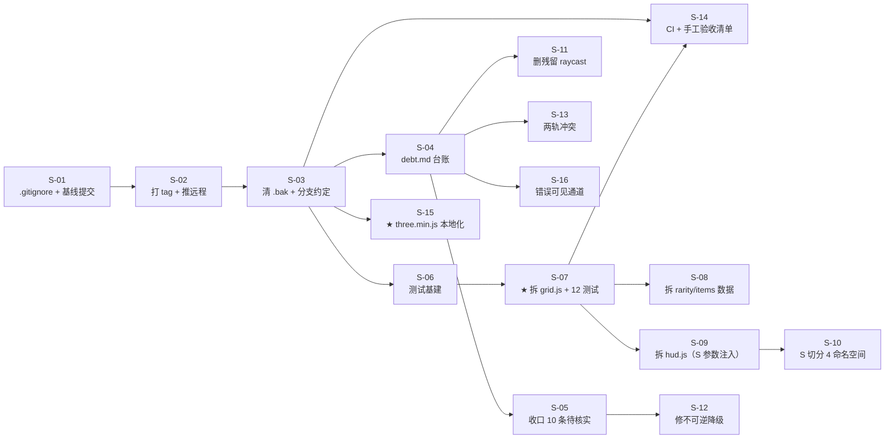

# S1 Backlog — Epic 列表与首批 Story

> **输入**：`docs/architecture/overview.md`、`docs/architecture/adr/ADR-001..004`
> **产出目标**：把「已诊断的问题」变成「可判定完成的工作」，让项目从「能跑但不能改」过渡到「能改且改坏了知道」。
>
> **规模约定**：S = 半天内，M = 1–2 天，L = 3 天以上（单人节奏）
> **DoD 约定**：每条必须是「可判定」的——有命令、有数字、有文件路径。不接受「代码更清晰了」这类描述。

---

## 0. Epic 总览

| Epic | 标题 | 为什么现在做 | 规模 | 依赖 |
|---|---|---|---:|---|
| **E1** | 版本管理建制与资产止血 | 23 个模块（含整个渲染管线）不在 git 里，硬盘一坏倒退三个月。这是唯一「不做就可能永久损失」的 Epic | S | 无 |
| **E2** | 文档骨架补齐 | 已交付 `overview.md` + 4 条 ADR；还缺「代码与文档不一致的收口」与债务台账 | S | E1 |
| **E3** | 测试基建与首个被测单元 | 只有 1 个测试（`tests/map-differences.mjs`），任何重构仍无回归保护。先建立「一条命令跑全部测试」这件事本身 | M | E1 |
| **E4** | `game.js` 拆分第一步 | 10,837 行是全部技术债的放大器。先拆零依赖的 `grid.js`，验证拆分流程可行 | M | E3 |
| **E5** | 已知缺陷收口（红线违规与不可逆降级） | 三条已确认的真实缺陷：降级残留 raycast、`_apply(3)` 不可逆、两套自适应互相拉扯 | M | E2 |
| **E6** | 质量闸门（CI + 手工验收清单） | 让人（和机器）在提交前就能发现「打开是黑屏」 | S | E1, E3 |

**建议执行顺序**：**E1 → E2（部分）→ E6 → E3 → E4 → E5**。

理由：E1 是止血，今天必须做；E2 让后面所有工作有依据；E6 最便宜、立刻防止「提交一个打不开的版本」；E3 → E4 是配套的（测试基建的第一个用户就是 `grid.js`）；E5 是三处具体缺陷，可以并行也可以最后收。

---

## E1：版本管理建制与资产止血

### 背景

```
提交数：1  (ddf204a, 2026-07-24)
未提交：54 项（含 23 个未跟踪的顶层模块 + 12 个 vendor 文件）
远程：  origin/master 与本地同点 → 远程也只有 3933 行的旧版本

game.js：已提交 3,933 行 / 工作区 10,837 行（+6,904 行，+175%）
index.html：621 行 / 1,453 行
未跟踪的 23 个模块包含整个渲染管线（render_pipeline / pbr_textures /
graphics_enhancement / world_polish / performance_guard / enemy_ai /
boss_system_v2 ×2 / item_models / world_props）与全部 vendor/
```

**风险陈述**：当前「唯一一份完整代码」只存在于这台机器的磁盘上。任何一次磁盘故障、误删、误 `git checkout --` 都会导致三个月的渲染与 AI 工作全部失效，且无法从远程恢复。

---

### S-01 · 补齐 `.gitignore` 并提交现存基线

- **ID**：S1-E1-01
- **规模**：S
- **负责角色**：engineering-lead（技术负责人）
- **描述**：先让 `git add` 变得安全，再把现存代码一次性纳入基线。当前 `.gitignore` 只有 IDE / OS / `.context/` / `.hermes/` / `node_modules/` / `dist/` / `build/`，完全不覆盖 `*.bak` 与截图，直接 `git add .` 会把 6 个 `.bak`（约 2.1 MB）和 4 张截图（约 4.5 MB）塞进仓库。
- **DoD**：
  1. `.gitignore` 新增以下条目，且 `git status --short` 的输出中**不再出现** `*.bak`、`*.png`、`.workbuddy/`：
     ```
     *.bak
     *.bak2
     *.bak3
     *.png
     .workbuddy/
     ```
  2. **确认以下目录仍被跟踪**（它们是运行时依赖，`双击 index.html` 能跑全靠它们）：`vendor/`、`models/`、`audio/`、`收藏品/`、`搜索音效/`、`装备及药品等杂项/`。用 `git ls-files vendor | wc -l` 应为 **11**（GLTFLoader + SkeletonUtils + postprocessing×6 + shaders×3）。
  3. 一次提交所有现存改动，commit message 形如：
     ```
     chore: 收口三个月未版本化的改动，建立 S1 基线

     纳入基线的 23 个未跟踪模块：
     render_pipeline / pbr_textures / graphics_enhancement / world_polish /
     performance_guard / perf_manager / enemy_ai / boss_system_v2 /
     boss_system_v2_extensions / item_models / item_icons / inspect_viewer /
     world_props / audio_engine / weapon_fx / weapon_ads_system /
     animation_enhancement / hud_feedback / settings / skill_tree_ui /
     resource_loader / collectibles_config / red_collectibles_config
     ```
  4. 提交后 `git status --short` 为空（工作区干净）。
  5. `git ls-files '*.js' | grep -v '^vendor/' | wc -l` = **27**（`game.js` + 23 个根目录模块 + `map/*.js` × 3）。
  6. `du -sh .git` 增量在 60 MB 以内（含 vendor 与大资源目录，属预期）。
- **依赖**：无
- **风险**：`models/` 与资源目录可能很大，首次提交较慢。若超过 100 MB，考虑把 `models/` 用 Git LFS（**需拍板**，见 §3）。

---

### S-02 · 打基线 tag 并推送到远程

- **ID**：S1-E1-02
- **规模**：S
- **负责角色**：engineering-lead
- **描述**：S-01 只是本地提交，远程 `origin/master` 仍然停在 3933 行的旧版本。**只有推送完成，备份才真正生效。**
- **DoD**：
  1. `git tag baseline/s1-working-2026xx`（打一个可回退锚点）。
  2. `git push origin master --tags` 成功。
  3. `git rev-list --left-right --count origin/master...master` 输出 `0	0`。
  4. 在浏览器里打开 GitHub 仓库页面，确认能看到 `game.js` 为 10,837 行、`vendor/` 目录存在。
- **依赖**：S-01
- **备注**：**这是整个 S1 里唯一必须当天完成的一条。** 其余 Story 都可以明天再做。

---

### S-03 · 清理 `game.js.bak` 系列并建立分支/提交约定

- **ID**：S1-E1-03
- **规模**：S
- **负责角色**：engineering-lead
- **描述**：删除 6 个手工备份文件（`game.js.bak` / `.bak2` / `.bak3`、`map/*.js.bak` × 3），历史交给 git；并把分支与 commit 前缀约定写进 `README.md`。
- **DoD**：
  1. 以下文件不存在：`game.js.bak`、`game.js.bak2`、`game.js.bak3`、`map/forest_outpost.js.bak`、`map/industrial_port.js.bak`、`map/military_base.js.bak`。
  2. 删除前已确认 `git show baseline/s1-working:game.js` 能取出完整版本（即：备份已进 git）。
  3. `README.md` 新增「开发约定」一节，至少包含：
     - `master` = 总能双击打开跑通的状态；改动走 `wip/<主题>`
     - commit 前缀：`feat:` / `fix:` / `perf:` / `refactor:` / `docs:` / `chore:`
     - 合并前三条手工验收（见 S-05 的清单）
  4. 删除备份后 `node --check *.js` 全部通过（确认没误删真文件）。
- **依赖**：S-02
- **风险**：低。若担心，先只删 `.bak2` / `.bak3`（旧的两个），保留 `.bak` 一周。

---

## E2：文档骨架补齐

### 已交付（本轮完成，无需 Story）

| 文件 | 状态 |
|---|---|
| `docs/architecture/overview.md` | ✅ 四层分层 / 初始化时序 / 主循环分频 / **四条红线（含违反症状）** / `game.js` 拆分建议 / 版本管理风险 / 10 条待核实 |
| `docs/architecture/adr/ADR-001-threejs-r128-no-build.md` | ✅ 4 条备选方案 |
| `docs/architecture/adr/ADR-002-analytic-collision-over-mesh-raycast.md` | ✅ 4 条备选 + 1 条残留违规 |
| `docs/architecture/adr/ADR-003-procedural-pbr-shared-textures.md` | ✅ 5 条备选 + 材质红线 |
| `docs/architecture/adr/ADR-004-adaptive-quality-guard.md` | ✅ 6 条备选 + 1 个内部矛盾 |

### S-04 · 建立技术债台账 `docs/architecture/debt.md`

- **ID**：S1-E2-04
- **规模**：S
- **负责角色**：engineering-lead
- **描述**：当前 24,342 行代码里 **0 个 `TODO` / `FIXME` / `HACK`**。这不是「债务少」，是「债务没有记账」。把 `overview.md` §6 的红线检查项、§7.2 的风险表、§8.2 的附带风险、§9 的 10 条待核实逐条转成可勾选条目。
- **DoD**：
  1. `docs/architecture/debt.md` 存在，包含至少 15 条，每条必含四栏：`ID` / `症状（用户可见的表现）` / `位置（文件:函数）` / `来源（ADR 编号或 overview 章节）`。
  2. 至少收录以下 6 条（已确认存在，非推测）：
     - `game.js:3388` 降级 AI 分支每帧调 `hasLineOfSight`（无节流）
     - `performance_guard._apply(3)` 把 `normalMap = null` 且不备份 → 不可逆
     - `render_pipeline.setLowMode(false)` 不恢复 `_scene.environment`
     - 轨道 A（PerformanceGuard）与轨道 B（`_adaptResolution`）互相拉扯
     - 首局 `rebuildMapEnvironment` 时 `GraphicsEnhancement.isEnabled() === false` → 不做静态合批
     - `S` 单例四合一（战斗/进度/背包/UI 标志）
  3. `.github/copilot-instructions.md` 或 `README.md` 里加入一行约定：新增债务必须写 `TODO(模块, 日期): 见 debt.md#ID`。
- **依赖**：E1
- **备注**：这份台账是 S1 之后所有性能/重构工作的入口。**没有它，`overview.md` 会变成一份很快过期的说明书。**

---

### S-05 · 收口 `overview.md` §9 的 10 条待核实

- **ID**：S1-E2-05
- **规模**：M
- **负责角色**：engineering-lead
- **描述**：`overview.md` §9 列出了 10 条「未能确认、但会显著影响判断」的点。其中 4 条（#1 双后期链是否重复生效、#2 `normalMap` 能否恢复、#3 `upgradeEnvironmentMaterials` 是否重建法线、#4 `MAP_DATA` 深拷贝后是否有陈旧引用）直接影响 E5 的修法。必须逐条核实并回填结论。
- **DoD**：
  1. `overview.md` §9 的 10 行全部从「待核实」改为「已核实：<结论>」或「已决策不做：<理由>」，并附核实方法（命令 / 断点 / 日志）。
  2. 至少对 #1 给出量化结论：`?perfdebug=1` 下，`RenderPipeline` 生效 vs `GraphicsEnhancement` 生效，`window.__perfFrame.render` 的毫秒差是多少。
  3. 至少对 #2 / #3 给出明确判定：3 级降级后，切一次地图，`normalMap` 是否恢复为 `null`（断点 `graphics_enhancement.js:636` 读 `mesh.material.normalMap`）。
  4. #4 给出结论：`grep -n "MAP_DATA\.\(theme\|roads\|trees\|buildings\)" *.js` 的结果中，是否存在模块级缓存变量。
  5. 结论回填后，`ADR-003` §3.2 与 `ADR-004` §3.2 中标注「待核实」的段落同步更新。
- **依赖**：S-04
- **规模说明**：M 是因为 #1 需要跑对比测量，不是读代码能得出。

---

## E3：测试基建与首个被测单元

### S-06 · 建立最小可运行的测试基建

- **ID**：S1-E3-06
- **规模**：M
- **负责角色**：engineering-lead
- **现状更新**：`tests/map-differences.mjs` 已作为**第一个真实测试**存在（S1-5 地图差异化缺陷修复时建立，33 项断言，`node tests/map-differences.mjs` 退出码 0）。它已经确立了本项目的测试范式：**零依赖、`.mjs`、`vm.runInContext` 加载 `var` 全局、自建 20 行断言**。S-06 应以此为起点扩成统一入口 `run.js`，而不是从空目录重新设计。
- **描述**：`tests/` 目录原本为空。在无构建、无 `package.json` 的约束下（ADR-001），测试不能依赖 npm 生态。方案：一个零依赖的 `tests/run.js`，用 Node 内置 `assert` + 一个 20 行的极简 runner，通过 `node tests/run.js` 依次执行各 `*.test.mjs`。
- **关键约束**：被测代码是「IIFE 挂全局」的浏览器脚本，不能直接 `require`。**第一步不要试图加载整个 `game.js`**（它会 `new THREE.Scene()` 并触碰 `document`）。只测纯函数模块——这正是 S-07 先拆 `grid.js` 的原因。
- **DoD**：
  1. `tests/run.js` 存在，`node tests/run.js` 退出码为 0，输出形如：
     ```
     ✓ grid: canPlaceInGrid 越界返回 false
     ✓ grid: autoSortGrid 后无重叠
     ...
     12 passed, 0 failed
     ```
  2. 失败时退出码非 0，且打印 `文件:行号` 与期望/实际值。
  3. `tests/README.md`（不超过 30 行）说明：如何新增用例、为什么不引入 npm、如何测浏览器侧代码（留给 S-11）。
  4. 在 `README.md` 的「开发约定」里加入：`node tests/run.js` 必须通过才能合并。
- **依赖**：E1（需要 git 才能谈「合并前必须通过」）
- **不做**：不引入 Jest/Vitest/Mocha。ADR-001 明确「零依赖」，测试基建也不该破例。

---

### S-07 · 拆出 `src/core/grid.js` 并配 12+ 条单元测试

> **这是整个 S1 的第一优先技术任务。** 它是唯一「零外部依赖 + 有明确输入输出 + 有真实业务价值」的代码块，风险接近于零，收益是「团队第一次有了可执行的回归网」。

- **ID**：S1-E3-07
- **规模**：M
- **负责角色**：engineering-lead
- **描述**：把 `game.js` 的 `SECTION 4 GRID HELPERS`（`game.js:848-924`）连同其后的纯算法函数 `canDropAt`(928) / `moveGridItem`(941) / `autoSortGrid`(953) 抽成独立模块 `src/core/grid.js`，并补齐测试。
- **待迁移函数**（共 11 个，全部是纯函数或只操作传入的对象）：
  ```
  canPlaceInGrid / placeInGrid / removeFromGrid / findFreeSlot / initGrid
  countGridItems / gridIsEmpty / canDropAt / moveGridItem / autoSortGrid
  takeContainerItem
  ```
- **明确不迁移**：`game.js:925-1047` 的 `Drag & Drop` 段（`onDragStart` / `onDragOverCell` / `onDropOnCell` / `onDragEnd`）以及 `game.js:10175-10563` 的「拖拽丢弃系统」。这两段依赖 DOM 事件与全局 `dragData`，不属于纯算法，留到第 2 批。
- **硬约束（不要做超出范围的事）**：
  1. **不要改数据形状。** `initGrid(rows)` 的返回结构 `{cols, _items: [...]}` 保持不变。`S.secureContainer` / `S.backpack` / `P.stashGrid` 都依赖它，改了会全线炸。
  2. **不要改函数签名。** 11 个函数的参数顺序与返回值语义完全保持。
  3. **不要顺手重构**（不要改成 class、不要加 TS 注解、不要拆更小的文件）。这一条的目标是「位移 + 加测试」，任何额外改动都会让「是否引入回归」不可判断。
- **DoD**：
  1. `src/core/grid.js` 存在，导出一个全局 `Grid`（IIFE，与现有风格一致），暴露上述 11 个函数。
  2. `index.html` 在 `game.js` **之前**加入 `<script src="src/core/grid.js"></script>`，且 `game.js` 中不再定义这 11 个函数（改为从全局 `Grid` 转引用或直接改名调用）。
  3. **浏览器侧零行为变化**：手工验收 ①新开一局、捡 3 个物品放进背包 ②自动整理一次 ③把物品拖到背包外丢弃、再撤销 —— 三项与拆分前表现完全一致。
  4. `tests/` 下至少 12 条用例，覆盖：
     - 放入越界（负坐标 / 超出 `cols` / 超出 `rows`）
     - 与已有物品重叠
     - 多格物品（`w×h > 1`）的占位
     - `autoSortGrid` 后无重叠且数量不变
     - `initGrid(null)` / `initGrid(0)` 的边界
     - `takeContainerItem` 从容器移除后网格状态
  5. `node tests/run.js` 全绿。
  6. `wc -l game.js` 比拆分前减少约 150 行（允许 ±20 行浮动，因为要加 `Grid.` 前缀）。
- **依赖**：S-06
- **风险**：低。唯一的坑是 `index.html` 的脚本顺序——`src/core/grid.js` 必须在 `game.js` 之前、且在 `three.js` 之后（虽然它不用 THREE，但保持「基础设施先于玩法」的一致顺序）。
- **为什么它是第一步**：见 `overview.md` §7.3。它同时验证了三件事：①拆分流程可行 ②`index.html` 顺序维护可控 ③测试基建能用。**如果这一步就走不通，说明整体拆分策略需要重新评估——那也是有价值的结论。**

---

## E4：`game.js` 拆分第一步（后续批次）

> E3 的 S-07 是「第一批」的第一项。以下是把第一批做完的 Story。

### S-08 · 拆出 `src/data/rarity.js` 与 `src/data/items.js`

- **ID**：S1-E4-08
- **规模**：M
- **负责角色**：engineering-lead
- **描述**：把 `game.js:6-66`（`RARITY` + `CONFIG`）与 `game.js:67-533`（`WEAPONS` + `ITEMS` + `_itemImgs` + `_weaponImgs` + `CONTAINER_TYPES` + `SHOP_PRICES`）拆成纯数据模块。
- **DoD**：
  1. `src/data/rarity.js` 与 `src/data/items.js` 存在，`index.html` 中加载顺序在 `grid.js` 之前（纯数据最先）。
  2. **`CONFIG` 保持可变**。注意：`loadMapData()`（`game.js:1067-1069`）会改写 `CONFIG.mapSize` / `gameTime` / `enemyCount`。如果把它改成不可变对象（`Object.freeze`）或拆成 `const` 字面量导出，**地图切换会断**。这一点必须保持原样，并在文件头注释里写清「`mapSize`/`gameTime`/`enemyCount` 会被 `loadMapData` 覆盖」。
  3. 增加一个数据校验脚本 `tests/check-items.js`：遍历 `ITEMS`，断言每个条目有 `name` / `rarity` / `value` / `w` / `h`，且 `rarity` ∈ `RARITY` 的键；输出「共 N 项，M 项缺字段」。
  4. `node tests/check-items.js` 输出缺失清单（**允许有缺失**——这一步的目的是「让缺失可见」，不是「一次性补齐」）。
  5. 手工验收：进大厅能打开商城、能配装、能进图捡到物品。
- **依赖**：S-07
- **价值**：`ITEMS` 有 20+ 个可选字段、无任何 schema。这个 Story 让「物品表有多少条不完整」第一次变成可查询的数字。

---

### S-09 · 拆出 `src/ui/hud.js`

- **ID**：S1-E4-09
- **规模**：L
- **负责角色**：engineering-lead
- **描述**：把 `game.js:6951-7667`（`SECTION 14 HUD` + `Full Map System` + `Marker Guide HUD`，约 716 行）拆出。这一块边界清晰（只读 `S`），是验证「依赖 `S` 的模块能否安全拆出」的第一个试验。
- **DoD**：
  1. `src/ui/hud.js` 存在，暴露 `updateHUD` / `updateWeaponUI` / `updateCompass` / `updateMinimap` / `drawFullMap` / `updateMarkerGuide`。
  2. **`S` 以参数注入**，不在模块内直接引用全局 `S`。签名形如 `Hud.updateHUD(S, PerfManager)`，由 `game.js` 的主循环调用 `Hud.updateHUD(S, PerfManager)`。这是为 ADR-001 方案 C 建立的第一个正面样板。
  3. `PerfManager.tick` 的 20/12.5/30 Hz 分频链路不变，`?perfdebug=1` 下 `window.__perfFrame.js` 与拆分前相比**不超过 +1 ms**。
  4. 手工验收：血量/弹药/负重/罗盘/小地图/大地图/撤离点标记全部正常刷新。
  5. `wc -l game.js` 减少约 700 行。
- **依赖**：S-07（需要 `grid.js` 先出，验证流程）
- **风险**：中。HUD 里有 30+ 处被 `game.js` 的事件回调直接调用（受伤/拾取/搜索/换枪）。改为 `Hud.xxx()` 时要逐处确认没有遗漏，漏一处就是「某个操作后 HUD 不刷新」。
- **备注**：这一 Story 的**真正产出不是「少了 700 行」**，而是「证明了 `S` 可以被参数注入」这个范式可复用。后续 S 都以它为模板。

---

### S-10 · 拆解 `S`：按职责切分为 4 个命名空间

- **ID**：S1-E4-10
- **规模**：L
- **负责角色**：engineering-lead
- **描述**：这是所有后续深层拆分（`inventory` / `combat` / `lobby`）的**前置条件**。`S` 当前是四合一（见 `overview.md` §2.1）：战斗状态 / 局内进度 / 背包装备 / UI 标志。不切分就拆任何玩法模块，都会把整个 `S` 搬走，等于没拆。
- **DoD**：
  1. `S` 拆为四个命名空间，但**保持 `S` 作为只读聚合视图存在**（避免一次性改 6 个模块的 30+ 处引用）：
     ```
     S.combat   = { health, maxHealth, armor, helmet, magAmmo, reserveAmmo, isReloading, lastShot, stamina, isCrouching, bleeding, fracture, weaponJammed, ... }
     S.raid     = { mode, phase, lootValue, kills, containersSearched, extractProgress, startTime, gameTime, isExtracting, ... }
     S.inventory= { weaponSlots, equipment, pockets, maxPockets, keychain, secureContainer, backpack, backpackCols, backpackRows, ... }
     S.ui       = { _fullMapOpen, _mapMarkers, _lastLootValue, _redCountAtOpen, _redSnapshotAtOpen, _pendingRedGroundPickup, _killStreak, ... }
     ```
  2. 提供 `Object.defineProperty` 定义的向后兼容别名（`S.health` → `S.combat.health`），使现有 30+ 处引用**无需修改**。这是关键：**先切结构、不改调用点**，让"一个 commit 只做一件事"。
  3. `startGame()`（`game.js:9914-9948`）的「保存→重置→恢复」序列可以被简化为「只重置 `S.raid`，`S.inventory` 不动」。DoD 判据：删除至少 10 行手工 save/restore 代码。
  4. 手工验收：新开一局后护甲/头盔/背包/保险箱内容正确保留（这是 `startGame` 里 save/restore 序列存在的唯一理由，必须逐项确认）。
  5. `docs/architecture/overview.md` §2.1 更新为「已切分为 4 个命名空间」。
- **依赖**：S-09（先用 HUD 验证注入范式）
- **风险**：**高**。这是 S1 里唯一「做错了会全线崩」的 Story。缓解：①严格按「先加命名空间 + 别名，不改调用点」的顺序 ②每切一个命名空间就手工跑一局 ③`Object.defineProperty` 的别名用 `get`/`set` 双向映射，不要只做 `get`。
- **建议**：这条可以放到 S2，不必挤在 S1 完成。S1 只需它「被拆出来并排上优先级」。

---

## E5：已知缺陷收口

> 以下三条都是**已确认存在**的缺陷（非推测），来源见各条 `依赖`。

### S-11 · 删除 `game.js:3388` 降级 AI 分支的每帧 raycast

- **ID**：S1-E5-11
- **规模**：S
- **负责角色**：engineering-lead
- **描述**：`overview.md` §6.3 与 `ADR-002` §3.3 记录的残留违规。`game.js:3336` `updateEnemies()` 的 `else` 分支（`typeof EnemyAI === 'undefined'` 时）每敌每帧调 `hasLineOfSight()`，无 120 ms 节流。当前不可达（`enemy_ai.js` 正常加载），但一旦 `enemy_ai.js` 加载失败，ADR-002 修复的那个「单帧 399 ms / FPS 3」会以「降级路径」的形式复活。
- **DoD**（二选一，需拍板见 §3）：
  - **方案 A（推荐）**：给降级分支加同样的 120 ms 节流，复用 `enemy._losNext` 字段。
  - **方案 B**：删除整个降级分支，把 `enemy_ai.js` 变成硬依赖（在 `init()` 里断言 `typeof EnemyAI !== 'undefined'`，否则显示明确错误）。
  - 无论哪种：`grep -n "hasLineOfSight(" *.js` 的结果只有 2 处（`enemy_ai.js:241` 带节流、`game.js:4765` 定义），或 3 处且 `game.js` 那处带 `_losNext` 节流。
  3. 手工验收：`?perfdebug=1`，硬核模式（72 敌人），`window.__perfFrame.js` < 8 ms。
- **依赖**：S-04（需先在 debt.md 登记）
- **规模说明**：S 是因为逻辑改动极小；真正的成本是「验证降级路径」——需要临时把 `enemy_ai.js` 从 `index.html` 注释掉来触发该分支。

---

### S-12 · 修复 `_apply(3)` 的不可逆材质修改（`normalMap` / `envMapIntensity` / `_scene.environment`）

- **ID**：S1-E5-12
- **规模**：M
- **负责角色**：engineering-lead
- **描述**：`ADR-004` §3.2 记录。`performance_guard.js:82-92` 在 3 级降级时遍历场景把 `m.normalMap = null`、`m.envMapIntensity → 0.1`，**不备份**；`render_pipeline.js:806-818` 的 `setLowMode(true)` 把 `_scene.environment = null`，而 `setLowMode(false)` **没有恢复它的分支**。合起来的症状：玩到 3 级降级后，即使帧率恢复，画面也永久变平、金属永久变塑料。
- **前置条件**：必须等 S-05 核实完 `overview.md` §9-#2/#3（`upgradeEnvironmentMaterials` 是否每次调用都重新赋 `normalMap`），否则不知道「切图能否恢复」。
- **DoD**：
  1. 3 级降级时备份引用：`m.userData._envBak = { normalMap: m.normalMap, envMapIntensity: m.envMapIntensity }`（只备份一次，`if (!m.userData._envBak)`）。
  2. 提供恢复路径 `PerformanceGuard.restoreMaterials()`，或让 `RenderPipeline.applyQuality()` 在 `_lowMode === false` 时恢复备份。
  3. `setLowMode(false)` 增加 `_scene.environment` 的恢复（需要先缓存原 PMREM 渲染目标到 `_envRT`，该变量已存在但目前只在 `setTheme` 里赋值——**需核实**）。
  4. 验证脚本或手工步骤写进 `tests/README.md`：`?perf=low` 强制降到 3 级 → 截一张图 → 改回 `?perf=off` 重进 → 截图对比，法线细节应恢复。
  5. `docs/architecture/debt.md` 中对应条目从「未修」改为「已修」并附 commit hash。
- **依赖**：S-05、S-04
- **风险**：中。`_scene.environment` 的恢复依赖 `RenderPipeline` 内部缓存了 PMREM 目标（`_envRT`），需确认 `setLowMode(false)` 时该目标仍然有效（没有被 dispose）。

---

### S-13 · 修复两套自适应控制器的互相拉扯

- **ID**：S1-E5-13
- **规模**：M
- **负责角色**：engineering-lead
- **描述**：`ADR-004` §3.3 记录的**逻辑真实存在的冲突**。轨道 A（`PerformanceGuard`，只降不升、`_done` 后永久停止）与轨道 B（`_adaptResolution`，双向、fps > 57 持续 4 秒就把 dpr 升回去）同时控制 `_dpr`。且 `PerformanceGuard._apply(1)` 主动把 `g.dynamicResolution` 设为 `true`（`performance_guard.js:61`），等于**把轨道 B 打开**。结果：守卫把分辨率压到 0.65 → 帧率恢复 → 轨道 B 慢慢升回 1.25 → 帧率再次崩 → 但守卫已 `_done`，不再降。
- **DoD**（推荐方案 ii，需拍板见 §3）：
  1. `render_pipeline.js` 新增 `let _dprFloor = 0`；`setResolutionScale(v)` 同时设 `_dprFloor = v`。
  2. `_adaptResolution()` 的上升分支增加 `_dpr < cap && _dprFloor === 0 || _dpr < Math.min(cap, _dprFloor === 0 ? cap : cap)` 的正确上界判断——具体实现应保证「轨道 B 不能把 dpr 升到高于 `_dprFloor` 设定值的水平」。
  3. 提供一个可观测断言：`RenderPipeline.getStats()` 增加返回 `dprFloor` 字段。
  4. 复现验证：`?perf=low`（强制降到 3 级，`setResolutionScale(0.65)`）→ 等待 30 秒 → 断点读 `RenderPipeline.getStats().dpr`，应为 0.65 而非回升到 1.25。
  5. `ADR-004` §2.3 与 §3.3 更新为「已收敛」，并记录采纳的方案。
- **依赖**：S-04
- **风险**：中。若方案 ii 的实现细节有误，可能导致「dpr 永远上不去」（画质永久偏低）。必须有第 4 条的复现验证。

---

## E6：质量闸门

### S-14 · 加 `node --check` CI 与手工验收清单

- **ID**：S1-E6-14
- **规模**：S
- **负责角色**：engineering-lead
- **描述**：`.github/` 目前只有一个 `copilot-instructions.md`，无任何 workflow。加一个最便宜的闸门：语法检查 + 打开能跑。
- **DoD**：
  1. `.github/workflows/syntax.yml` 存在，在 push 与 PR 时运行：
     ```yaml
     - run: for f in $(git ls-files '*.js' | grep -v '^vendor/'); do node --check "$f"; done
     ```
     注意排除 `vendor/`（第三方代码，本身可能没问题但不应阻塞我们）。
  2. `node tests/run.js` 也纳入 CI（S-06 完成后）。
  3. `README.md` 新增「合并前 3 条手工验收」（这是 CI 无法覆盖的部分）：
     ```
     ① 双击 index.html → 能进大厅 → 能进图 → 能撤离（或死亡结算）
     ② 按 M 打开大地图，标记正常显示；按 B 打开背包，拖拽正常
     ③ 切一次地图（大厅选另一张图），进图后 : ?perfdebug=1 的 calls 明显低于首次进图（合批生效）
     ```
  4. CI 在 master 上绿。
- **依赖**：E1
- **价值**：第 ③ 条手工验收直接对应 `overview.md` §3.3 那个「首局不合批」的已知问题——它让这个隐性行为变成每次合并都会被看一眼的东西。

---

### S-15 · 把 `three.min.js` 收进 `vendor/`（消除 CDN 单点）

- **ID**：S1-E6-15
- **规模**：S
- **负责角色**：engineering-lead
- **描述**：`ADR-001` §6 第 3 条。当前 three.js 从 `cdnjs` CDN 加载（`index.html:1414`），`vendor/` 里**没有**它（已核实：`find vendor -iname "*three*"` 为空）。断网或 CDN 被墙时，双击 `index.html` 会白屏，且因为所有 `typeof THREE` 守卫的存在，**控制台不会报红字**，表现为「黑屏但无错误」——极难诊断。
- **DoD**：
  1. `vendor/three.min.js`（r128，约 600 KB）存在。
  2. `index.html:1414` 改为 `<script src="vendor/three.min.js"></script>`。
  3. 断网状态下双击 `index.html`，游戏能进大厅（`models/` 的 GLB 会加载失败但不应崩溃——需确认 `loadEnemyModels` 有容错）。
  4. `?perfdebug=1` 下功能与 CDN 版本完全一致。
- **依赖**：E1
- **备注**：**这是整个 S1 里性价比最高的一条。** 600 KB 换来「离线可玩 + 消除单点故障 + 加载不再依赖外网延迟」。

---

### S-16 · 加一个可见的「初始化失败」通道

- **ID**：S1-E6-16
- **规模**：S
- **负责角色**：engineering-lead
- **描述**：`overview.md` §6.4 的教训：`try/catch` + `console.warn` + `typeof` 守卫三重静默，把硬崩溃变成了「没人发现的功能缺失」。`rebuildMapEnvironment()` 里 `WorldProps` 的失败只打一条 `console.warn`（`game.js:1997`），在 39 个 script 的日志里根本看不见——这就是「所有道具一件都没生成」能长期存在的根本原因。
- **DoD**：
  1. 新增全局错误通道 `window.__initErrors = []`，所有 `init` 阶段的 `catch` 都 `push({module, message, stack})`。
  2. `rebuildMapEnvironment()` 的 sub-step 失败时，**在加载界面或 HUD 上显示一个可见提示**（复用 `PerformanceGuard._toast` 的样式），文案如「道具生成失败，部分场景缺失」。
  3. `?perfdebug=1` 下 `console.error` 输出完整错误，不再是 `warn`。
  4. 验证：临时在 `world_props.js` 里 `throw new Error('test')`，确认界面上出现提示、`window.__initErrors` 有 1 条记录。
  5. `docs/architecture/overview.md` §6.4 的「怎么查」段落补充这条通道的用法。
- **依赖**：S-04
- **价值**：这是**防止同类事故再次长期潜伏**的唯一系统性手段。E5 的三条修复是「修具体 bug」，这一条是「让下一个 bug 不再隐形」。

---

## 附录 A：依赖关系图



**★ 标记的两条是「投入产出比最高」的起点**：
- `S-15`（three.js 本地化）：600 KB、10 分钟、消除单点故障。
- `S-07`（拆 `grid.js`）：约 150 行代码、半天、第一次建立可执行回归网。

---

## 附录 B：S1 完成判定

S1 视为完成，当且仅当以下全部为真：

1. `git log --oneline | wc -l` ≥ 6，`git status --short` 为空，`origin/master` 与本地同点。
2. `git ls-files vendor | wc -l` = **12**（S-01 后的 11 个 + `three.min.js`）。
3. `node tests/run.js` 退出码 0，输出 ≥ 12 条通过用例。
4. `docs/architecture/` 下有：`overview.md`、`debt.md`、`adr/ADR-001..004`，且 `overview.md` §9 的 10 条待核实全部有结论。
5. `wc -l game.js` ≤ 10,700（`grid.js` 拆出后）。
6. `game.js` 中 `hasLineOfSight` 的每帧调用点已消除（S-11）。
7. 三条已知缺陷（S-11 / S-12 / S-13）在 `debt.md` 中标记为「已修」或「已决策不修 + 理由」。
8. 断网状态下双击 `index.html` 能进大厅（S-15）。

**未达成上述任一项，S1 不算完成。** 特别地，第 1 项与第 8 项与代码质量无关，但它们是「项目还在不在」的判据。

---

## 附录 C：待提交清单（**未执行**，等授权）

> 状态：`main` 已指令「拿到授权之前不要 commit、不要 push」。以下内容已准备好，**一条命令都没跑**。
> `.gitignore` 已改为目标状态（只是文件编辑，不产生任何提交）。

### C.1 `.gitignore` 目标状态（已落地）

在原有内容后追加：

```gitignore
# ---- 手工备份：历史交给 git，不再用 .bak 文件 ----
*.bak
*.bak2
*.bak3
*.orig
*.rej

# ---- 根目录临时截图（评审/调试产物，非运行时资源）----
/screenshot*.png
/ui_*.png
/bug.txt

# ---- 工具/会话临时目录 ----
.workbuddy/
```

**必须保留在版本库里、不得忽略**（它们是运行时依赖，`双击 index.html` 能跑全靠它们）：

```
vendor/            12 个文件（three.min.js + GLTFLoader + SkeletonUtils + postprocessing×6 + shaders×3）
models/            敌人/武器 GLB
audio/
收藏品/
搜索音效/
装备及药品等杂项/
```

**验证结果（已跑）**：`git status --short | grep -E '\.bak|\.png|workbuddy'` 输出为空；未跟踪项从 54 项降到 **38 项**；6 个 `.bak`（约 2.1 MB）与 4 张根目录截图（约 4.5 MB）已不再出现在待提交列表里。

### C.2 待提交分组（建议一次 commit，或按下列 3 组拆）

**第 1 组：运行时模块（23 个根目录 JS）**

```
animation_enhancement.js   audio_engine.js           boss_system_v2.js
boss_system_v2_extensions.js  collectibles_config.js enemy_ai.js
graphics_enhancement.js    hud_feedback.js           inspect_viewer.js
item_icons.js              item_models.js            pbr_textures.js
perf_manager.js            performance_guard.js      red_collectibles_config.js
render_pipeline.js         resource_loader.js        settings.js
skill_tree_ui.js           weapon_ads_system.js      weapon_fx.js
world_polish.js            world_props.js
```

**第 2 组：资源与第三方**

```
vendor/（12 个文件，含新增 vendor/three.min.js 603 KB）
models/  audio/  收藏品/  搜索音效/  装备及药品等杂项/
```

**第 3 组：已修改的已跟踪文件 + 新目录**

```
game.js        10,837 → 约 11,090 行（+ 诊断通道、- 降级 AI 分支）
index.html     1,453 行（three.js 改为本地 vendor 路径）
map/military_base.js  map/industrial_port.js  map/forest_outpost.js
docs/          （新增：架构文档 + 4 条 ADR）
production/    （新增：本 backlog）
tests/         （新增：map-differences.mjs + strategy/smoke-cases + harness + tools）
design/
README.md      freelance-profile.md  freelance-template.md  portfolio.html
游戏机制与内容丰富计划.md / .html
```

### C.3 拿到授权后要跑的命令（按顺序，**当前均未执行**）

```bash
# 1) 先确认 .gitignore 真的挡住了不该进的东西
git status --short | grep -E '\.bak|\.png|workbuddy'   # 期望：无输出

# 2) 暂存全部（此时 .gitignore 已生效，.bak/截图/workbuddy 不会进来）
git add -A

# 3) 提交前核对体量，若过大先确认是否误把 evidence 或大图加进来
git diff --cached --stat | tail -5

# 4) 一次性收口提交
git commit -F- <<'MSG'
chore: 收口三个月未版本化的改动，建立 S1 基线

纳入基线的 23 个未跟踪模块：
render_pipeline / pbr_textures / graphics_enhancement / world_polish /
performance_guard / perf_manager / enemy_ai / boss_system_v2 /
boss_system_v2_extensions / item_models / item_icons / inspect_viewer /
world_props / audio_engine / weapon_fx / weapon_ads_system /
animation_enhancement / hud_feedback / settings / skill_tree_ui /
resource_loader / collectibles_config / red_collectibles_config

同时纳入：
- vendor/（含新增 vendor/three.min.js，解除 CDN 单点依赖）
- docs/architecture/（overview + ADR-001..004）
- production/epics/S1-backlog.md
- tests/（map-differences.mjs + QA harness）

本批代码改动：
- fix(map): 三图差异化缺陷修复（kind 字段 / 雾距 / groundSurface / roofColor）
- perf(render): _dprFloor 收敛双轨自适应冲突；_syncFog 尊重地图配置
- fix(ai): 删除降级 AI 分支（每帧 raycast，复刻 399ms 事故），enemy_ai.js 改为硬依赖
- feat(diag): 新增 window.__initErrors 诊断通道 + 致命依赖全屏错误层
- chore(index.html): three.js 改为本地 vendor 路径
MSG

# 5) 打锚点 + 推远程（这一步才是备份真正生效）
git tag baseline/s1-working
git push origin master --tags
git rev-list --left-right --count origin/master...master   # 期望：0	0
```

### C.4 提交前必须人工确认的 3 件事

1. **`models/` 的总体积**。若 `.git` 增量超过 100 MB，说明资源没压过，先压缩再用普通 blob 提交（本决策已定：**不用 LFS**；若未来资源超 200 MB 再一次性迁移）。
2. **`tests/evidence/` 未被提交**。已在 `.gitignore` 中，但 QA 可能刚生成了新目录，`git diff --cached --stat` 里不应出现 `evidence/`。
3. **`vendor/three.min.js` 的 REVISION 必须是 128**。已验证：`REVISION = 128`，`WebGLRenderer / ACESFilmicToneMapping / sRGBEncoding / PMREMGenerator` 均在位，`UnrealBloomPass` 不在（符合 r128 不内置后期库的预期）。
